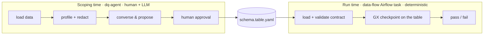

# dq-agent

[](https://github.com/JBarone90/dq-agent/actions/workflows/tests.yml)


**dq-agent helps a dataset owner write data-quality checks without writing code.** You point it at your data and describe its business context; it profiles the data and helps you assemble a **contract** — a [Great Expectations](https://greatexpectations.io/) 0.18.2 suite for one Postgres table. You approve the contract once, and from then on an Airflow task runs it **deterministically** on every pipeline run.

A large language model helps you _author_ the contract through a conversation, but it **never touches your data at execution time**. Approved checks run as Great Expectations expectations, not prompts. The LLM is a reasoning layer for scoping, not an execution engine.

The repo has two parts:

- **dq-agent** (`src/dq_agent/`): the scoping side — profiler, expectation catalogue, conversational agent and approval gate — driven from a terminal CLI (`scripts/scoping_cli.py`) or an optional Streamlit chat panel.
- **the data-flow kit** (`dataflow_kit/`): the run side, staged here and copied into the `data-flow` Airflow repo — one utility module, one example validation DAG, and the contracts folder.

> **Why Great Expectations?** At work, pipelines run only in Airflow and the department already uses Great Expectations (0.18.2) there, with results persisted to a validation store and shown on the monitoring dashboard. dq-agent therefore does not run checks itself: its product is a GX-native contract that the shared data-flow task runs. The differentiator is the step _before_ execution — turning a dataset owner's knowledge into a reviewed suite through conversation.

## Status

| Capability                                      | State                          |
| ----------------------------------------------- | ------------------------------ |
| Deterministic profiler (CSV + Postgres)         | **Done** — tested, usable      |
| Expectation catalogue (8 GX expectations)       | **Done** — tested              |
| Scoping agent + human approval gate             | **Working dev demo** (Phase 3) |
| data-flow kit (utility module + example DAG)    | **Pilot** — to be tried in data-flow |
| Creative mode — novel rule proposals            | Planned (Phase 4)              |

The Polars execution engine the project started with is retired; it is preserved on the `feat/bedrock-proxy-adapter` branch. See [ACTION_PLAN.md](ACTION_PLAN.md) for the full roadmap.

## Contents

### Guide

- [How it works](#how-it-works)
- [Quickstart](#quickstart)
- [The scoping agent](#the-scoping-agent)
- [Project structure](#project-structure)

### Concepts

- [The run side](#the-run-side)
- [The agentic layer](#the-agentic-layer)

### For developers

- [Development & testing](#development--testing)
- [Adding an expectation](#adding-an-expectation)
- [Design principles](#design-principles)

## How it works

The tool has two phases that never overlap in time. The only thing they share is the **contract YAML**: one phase produces it, the other consumes it.

```text
SCOPING TIME — once per table, human in the loop, LLM allowed (dq-agent)
  load data  →  profile (+ redact)  →  converse & propose expectations  →  human approval  →  <schema>.<table>.yaml

RUN TIME — every pipeline run, deterministic, no LLM anywhere (data-flow / Airflow)
  contract YAML  →  validate against allowlist  →  in-memory GX suite + checkpoint  →  pass / fail (fail raises)
```



The profiler informs which expectations to _propose_; Great Expectations _executes_ what was approved. The LLM only ever sees a **redacted** profiler report (aggregates and hints, no raw cell values).

## Quickstart

**Requirements:** Python ≥ 3.11 and [uv](https://docs.astral.sh/uv/).

```bash
uv sync --extra agents --extra dev
uv run python scripts/scoping_cli.py
```

The repo ships a dirty-by-design dataset (`data/synthetic/orders.csv` — 20 order rows with known issues: null customer ids, a duplicate order id, a negative amount, a malformed email, an unexpected status, a stale date) and the contract that covers it (`dataflow_kit/dq_contracts/synthetic.orders.yaml`). Loading and validating a contract is what the data-flow task does first:

```python
from dataflow_kit.dq_validation import load_contract

contract = load_contract("dataflow_kit/dq_contracts/synthetic.orders.yaml")  # raises ContractError if invalid
```

Running it needs Great Expectations 0.18.2 and a Postgres table, so it happens in data-flow — see [The run side](#the-run-side).


## The scoping agent

Phase 3 wraps the scoping workflow in a single LangGraph agent (`src/dq_agent/agents/scoping.py`). It converses with the dataset owner, profiles the dataset (`profile_dataset` — redacted report only, no raw cell values ever reach the LLM), browses the expectation catalogue (`list_rules`), and proposes a draft contract (`propose_contract`, validated against the same allowlist data-flow uses). Approval is a LangGraph `interrupt()`: the graph pauses and presents a plain-English summary of the proposed checks (`report.describe_contract`) alongside the full YAML; a human approves / edits / rejects, and only an approved contract is stamped (`approval.approved_at`, `approval.approved_by`) and persisted to `contracts/<schema>.<table>.yaml`, ready to commit to data-flow's `dq_contracts/` folder.

data-flow enforces the gate at run time: its loader rejects a contract without an `approval` block.

### Running the chat interface

> **Branch note (`feat/bedrock-proxy-adapter`).** This branch targets an air-gapped work
> environment with no npm mirror, so it does **not** use agent-chat-ui or a `langgraph dev`
> server. The interface is a local, in-process driver instead: a terminal CLI today, and an
> optional Streamlit chat panel for non-technical owners. The default model is the internal
> Bedrock proxy (`DeptBedrockChat`), not Gemini.

**1. Install the agent extra.**

```bash
uv sync --extra agents
```

The default model is `DeptBedrockChat` (`src/dq_agent/agents/bedrock_chat.py`), which reaches Anthropic-on-Bedrock through the internal `dwutils.bedrock` proxy — no API key, no internet. `dwutils` is an internal package assumed importable in the work environment; set `DQ_AGENT_MODEL` to pick a Bedrock model id (defaults to `eu.anthropic.claude-sonnet-5`). The `model` argument to `build_graph` stays injectable, so a different LangChain model can be substituted in tests or off-network experiments without code changes.

**2. Run the CLI.** From the repo root:

```bash
uv run python scripts/scoping_cli.py                       # in-memory session
uv run python scripts/scoping_cli.py --db scoping.sqlite   # durable, resumable thread
```

Then chat: point the agent at `data/synthetic/orders.csv`, describe the business context, and iterate on its proposal. When the agent proposes a contract it pauses at the approval gate and prints the plain-English review; type `approve` to accept (which writes the contract to `contracts/<schema>.<table>.yaml`) or type feedback to have it revise. `--db` keeps the thread on disk so you can stop and resume the same `--thread` later.

**Why the CLI compiles the graph with a checkpointer.** The approval gate is a LangGraph `interrupt()`: it pauses the run by persisting it to a checkpointer (keyed by `thread_id`) and resumes by looking it back up. Without a checkpointer the gate can never complete and no contract is produced — so the driver passes one in (`MemorySaver` by default, `SqliteSaver` with `--db`). On `main`, the `langgraph dev` server supplied this implicitly; here the driver owns it.

The approval interrupt uses the project's own HITL contract (`action_requests` + `review_configs`); `scoping.py:_decision()` normalizes the resume payload, including a free-text reply, so a plain terminal can drive the gate without rendered buttons.

**3. Or run the visual chat panel (Streamlit), for non-technical owners.** Same in-process graph and interrupt/resume contract as the CLI, rendered as a chat UI — npm-free (Streamlit's frontend ships inside its Python wheel):

```bash
uv run --extra ui streamlit run app/scoping_app.py
```

It shows the conversation with a toggle to reveal the agent's tool calls, and renders the approval gate as approve / edit / reject controls (edit lets the owner amend the contract YAML before approving). Token-usage and streaming readouts are scaffolded but inert until the Bedrock adapter surfaces usage and a `_stream` (see `DeptBedrockChat`).

## Project structure

```text
dq-agent/
├── src/dq_agent/
│   ├── registry.py     # loads the expectation catalogue; renders plain-English summaries
│   ├── models.py       # Contract — the GX envelope, validated by the data-flow allowlist
│   ├── profiler.py     # dataset profiler + redact() — scoping-time facts for the LLM
│   ├── connectors.py   # load CSV / Parquet / Postgres into a Polars DataFrame for profiling
│   ├── report.py       # describe_contract() — contract -> plain-English approval card
│   ├── harness.py      # scores a proposed contract vs the checks it should contain (recall)
│   └── agents/         # LangGraph scoping agent + human approval gate (Phase 3)
├── registry/rules/     # one YAML per allowed GX expectation — the catalogue the agent draws from
├── dataflow_kit/       # staged for the data-flow repo
│   ├── dq_validation.py  # allowlist, load/validate contract, run it as an in-memory GX checkpoint
│   ├── dags/             # example validation-only DAG
│   └── dq_contracts/     # one contract per table: <schema>.<table>.yaml
├── contracts/          # approved contracts the scoping agent persists land here (git-ignored)
├── proposals/          # creative-mode (Phase 4) outputs — empty until that phase lands
├── data/synthetic/     # dirty-by-design test dataset (orders.csv)
└── tests/
```

**Polars is the profiling representation.** Connectors load into a Polars DataFrame before profiling; execution happens in Great Expectations, inside the database.


## Concepts

The toolkit is two layers. The **run side** executes checks with no LLM involved, inside Airflow. The **scoping layer** sits on top and is how an LLM helps a human author a contract for the run side.

### The run side

#### Expectation

**The smallest unit — one check.** A Great Expectations expectation, used by its GX name and kwargs, e.g. `expect_column_values_to_not_be_null` with `{column: customer_id}`. Eight are allowed today, covering completeness, uniqueness, allowed values, ranges, text format, column type, row count and freshness.

#### Allowlist and registry

**Which expectations and kwargs a contract may use.** `ALLOWED_EXPECTATIONS` in `dataflow_kit/dq_validation.py` is the enforcement point: data-flow rejects anything outside it, so a contract cannot smuggle in arbitrary classes, actions or code. `registry/rules/` is the agent's view of the same list — a description, tags, kwarg docs and a plain-English `summary` per expectation. A test keeps the two identical.

#### Contract

**A GX suite for one table, approved by a human.** It is the boundary object — the one artifact the scoping layer produces and data-flow consumes:

```yaml
contract_version: 1
gx_version: "0.18.2"
dataset: { schema: synthetic, table: orders }
approval: { approved_at: 2026-10-08T00:00:00Z, approved_by: jacopo } # data-flow refuses to run without it
suite:
  name: synthetic.orders
  expectations:
    - expectation_type: expect_column_values_to_not_be_null
      kwargs: { column: customer_id }
      meta: { notes: { format: string, content: Every order must belong to a customer } }
    - expectation_type: expect_column_min_to_be_between # freshness, evaluated at run time
      kwargs: { column: created_at, min_value: { $PARAMETER: now() - timedelta(days=365) } }
```

Contracts never hold connection strings; the task reads the connection from the environment.

#### The data-flow task

`dataflow_kit/dags/dq_check_example.py` is a validation-only DAG. Its `@task.virtualenv` task calls `gx_get_context()` (data-flow's own `validation_utils`), `load_contract(contract_path(schema, table))` and `run_contract(...)`, which builds the suite and checkpoint in memory, runs them against the table and raises `DataQualityCheckFailed` on any failure — so Airflow marks the run failed. To validate after an ingestion pipeline instead, chain the same task after its sync (`sync_task >> check(...)`).

### The agentic layer

These exist only at scoping time, to help a human and an LLM produce a good contract for the deterministic layer above. The LLM appears only here — and even here it never sees raw data.

#### Profiler

**The agent's window into the dataset.** The profiler (`profiler.py`) is the main tool the agent uses to reason about data it cannot see directly. `profile()` produces a structured report — per-column stats, table stats, and semantic hints — that tells the agent _which expectations are worth proposing_: a column hinted `email` suggests `expect_column_values_to_match_regex`; a column with no nulls that the owner says is mandatory suggests `expect_column_values_to_not_be_null`. Per-column stats include null rate, uniqueness, min/max, and distribution; semantic hints cover `email`, `phone`, `id`, and `date`. It is pure, deterministic code; the LLM consults its output, it does not run it.

#### Redaction

**The data-protection boundary between the profiler and the LLM.** A full profile can contain raw cell values (e.g. the most common values in a column), which must never be sent to a model. `redact()` returns a copy that is safe to share: raw value _examples_ (top values) are dropped, while bounded aggregates (null rate, uniqueness, numeric/temporal min/max) are kept — enough signal to propose rules, no raw data. The redacted `email` column, for instance:

```json
{
  "name": "email",
  "dtype": "String",
  "null_rate": 0.0,
  "uniqueness_ratio": 1.0,
  "min": null,
  "max": null,
  "top_values": null,
  "semantic_hint": "email"
}
```

Redaction is enforced in the agent's tooling: the `profile_dataset` tool always returns the redacted report, so a raw value cannot reach the model even by accident.

#### Harness

**Regression-testing the scoping agent.** The harness (`harness.py`) compares a proposed contract with the hand-written list of `(expectation_type, column)` checks that cover each known issue, reporting **recall** (did it include every one?) and any **extra** checks. It exists so that a change to the system prompt, model, or registry that silently reduces coverage of known dataset issues is caught by an assertion like `score.recall == 1.0`.

## For developers

### Development & testing

Install the optional dependency groups you need:

| Command                    | Adds                                                    |
| -------------------------- | ------------------------------------------------------- |
| `uv sync`                  | core: Polars, Pydantic, PyYAML (also all the data-flow kit needs to load contracts) |
| `uv sync --extra dev`      | pytest, pytest-cov                                      |
| `uv sync --extra postgres` | ConnectorX (Postgres connector)                         |
| `uv sync --extra agents`   | LangGraph + LangChain + SQLite checkpointer (the scoping agent + CLI driver) |

Run the suite:

```bash
uv run pytest                                          # all tests
uv run pytest tests/test_registry.py::test_registry_matches_the_data_flow_allowlist   # a single test
uv run pytest --cov=src/dq_agent                       # with coverage
```

Integration tests (which make live LLM calls) are marked `integration` and are deselected in CI; they self-skip locally unless `DQ_AGENT_MODEL` is set. The Postgres test (identical profiler report from a file and a live table) skips unless `DQ_TEST_POSTGRES_URI` is set. To run it against a throwaway container:

```bash
docker run -d --name dq-test-pg -e POSTGRES_PASSWORD=dq -p 5433:5432 postgres:16
docker exec dq-test-pg psql -U postgres -c "CREATE TABLE orders (
  order_id INTEGER, customer_id TEXT, email TEXT, amount DOUBLE PRECISION,
  status TEXT, created_at DATE, phone TEXT);"
cat data/synthetic/orders.csv | docker exec -i dq-test-pg psql -U postgres \
  -c "\copy orders FROM STDIN WITH (FORMAT csv, HEADER true)"

DQ_TEST_POSTGRES_URI=postgresql://postgres:dq@localhost:5433/postgres uv run pytest
docker rm -f dq-test-pg
```

**CI** runs the suite on push to `main` and on every pull request, across Python 3.11–3.13 (`.github/workflows/tests.yml`).

### Adding an expectation

1. Add an entry to `ALLOWED_EXPECTATIONS` in `dataflow_kit/dq_validation.py`: its required and optional kwargs, each with a small type check. Only kwargs GX 0.18.2 actually accepts for that expectation.
2. Add `registry/rules/<expectation_type>.yaml` with the same kwargs, a description the agent can reason from, tags, and a `summary` template:

```yaml
id: expect_column_values_to_not_be_null
name: Not null
description: Fails if the column has null values. Set mostly below 1.0 to tolerate a share of nulls.
tags: [completeness]
kwargs:
  column: { type: str, required: true }
  mostly: { type: float, description: fraction of rows that must be non-null (default 1.0) }
summary: "`{column}` must never be empty"
```

3. Run the tests: `test_registry_matches_the_data_flow_allowlist` fails until the two agree. Then copy the updated `dq_validation.py` into data-flow.

Authoring standards live in `.claude/roles/rule-author.md`.

### Design principles

- **Registry first.** The quality of the expectation catalogue determines the quality of every contract the agent produces. Invest there.
- **Deterministic by default.** The LLM is a reasoning layer, not an execution layer. Approved checks run as Great Expectations expectations, not prompts.
- **Framework agnostic at the model layer.** LLM provider is a config value. Swap between Anthropic, OpenAI, or a local model without code changes.
- **GX-native, allowlisted contracts.** Contracts use Great Expectations 0.18.2 names and kwargs directly, inside a small envelope; a deterministic allowlist decides what may run. No translation layer, no generated code.
